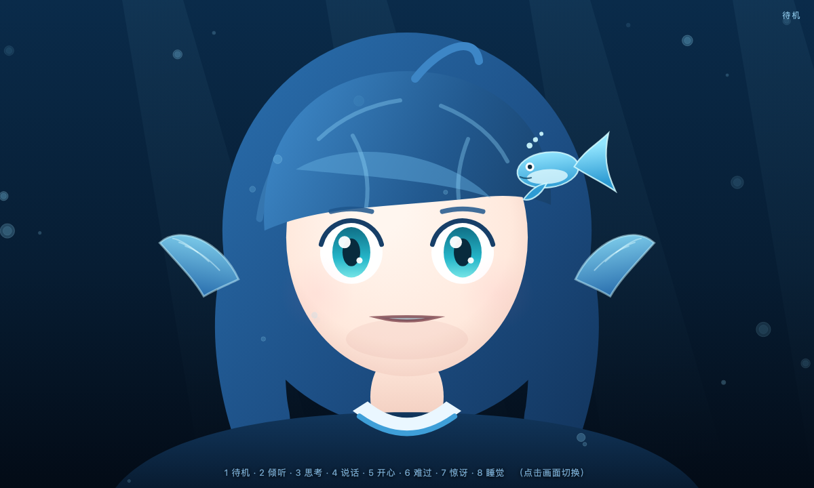
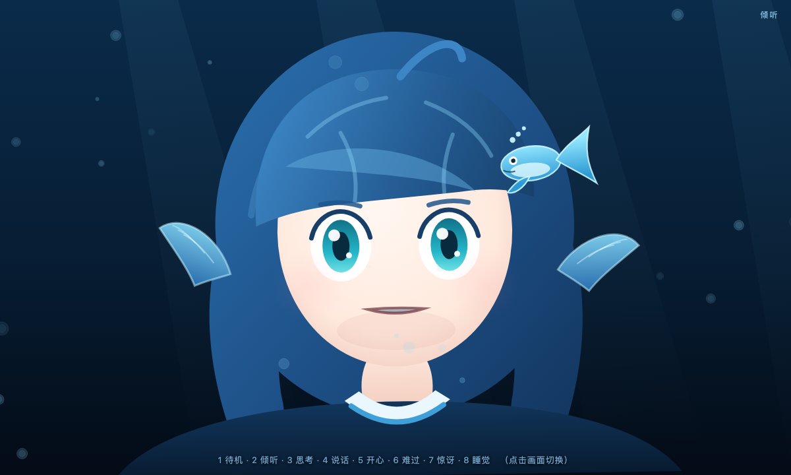
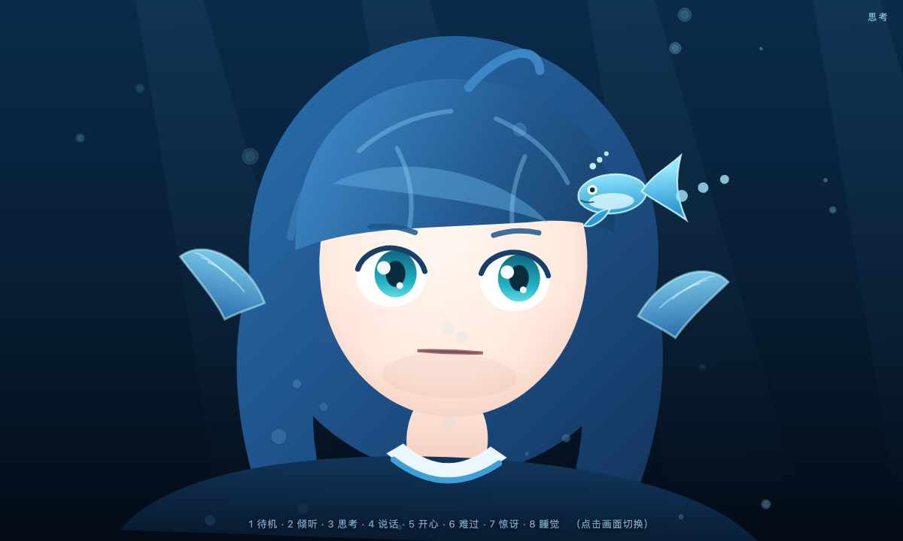
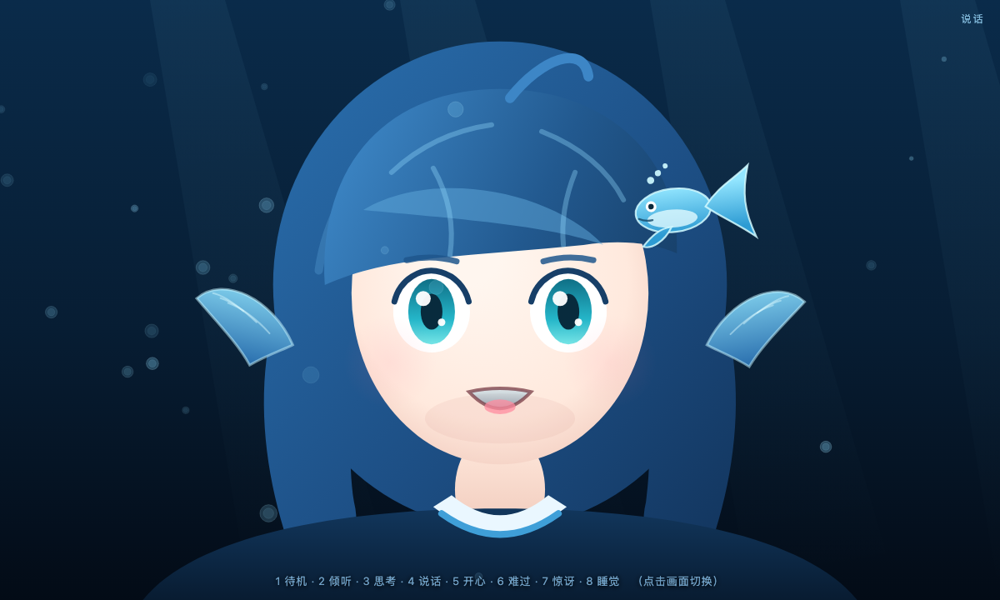
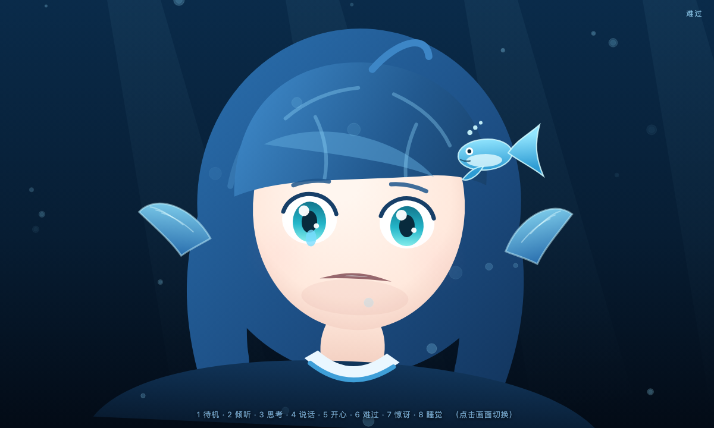
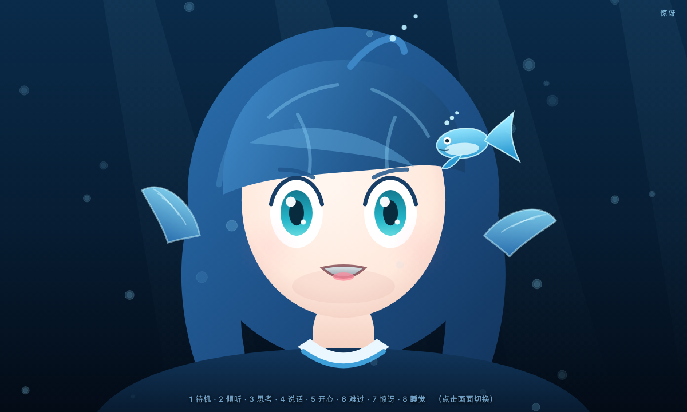
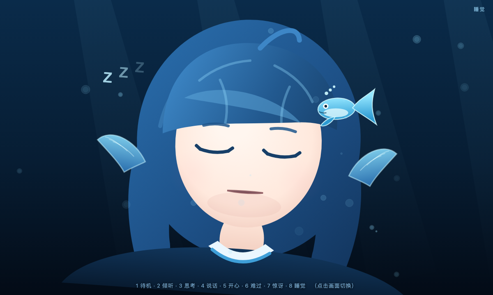

# 表情屏（浏览器原型）

两套可切换的脸，都是纯前端、零依赖，双击就能跑：

| 文件 | 风格 |
|---|---|
| `face.html` | 抽象机器人脸：极简、漂浮的眼睛和嘴 |
| `whale_face.html` | 鲸鱼娘（同人风格）：蓝发、鳍耳、鲸鱼发夹、水花 |

## 运行

```bash
# 直接双击，或者起个本地服务
python3 -m http.server 8000 -d starter/face
# 打开 http://localhost:8000/whale_face.html
```

## 操作

- 键盘 `1`–`8`：待机 / 倾听 / 思考 / 说话 / 开心 / 难过 / 惊讶 / 睡觉
- 点击画面：按顺序轮换
- 鼠标移动：待机和倾听时瞳孔跟随
- 空格：在"说话"和"待机"之间切换
- URL 参数：`whale_face.html?state=happy&instant=1`（`instant=1` 跳过过渡，截图用）

## 鲸鱼娘表情预览

| 待机 | 倾听 | 思考 | 说话 |
|---|---|---|---|
|  |  |  |  |

| 开心 | 难过 | 惊讶 | 睡觉 |
|---|---|---|---|
|  |  |  |  |

## 原理

每个表情是一组参数（`eyeOpen / pupilX / brow / mouth / curve / blush / eyeCurve / tilt / ear / tear / sparkle / zzz / spout`），切换时做缓动插值；眨眼、气泡、呆毛、水花都是时间驱动的小动画。要加新表情，在 `STATE_DEFS` 里加一组数即可。

## 接进机器人

页面暴露了：

```js
window.faceAPI.setState('listen');   // 任何能执行 JS 的容器都能调
```

- 开发阶段：浏览器打开，键盘/点击切换
- 部署阶段：树莓派 Chromium kiosk 全屏
  ```bash
  chromium-browser --kiosk --app=file:///home/pi/face/whale_face.html
  ```
- 联调阶段：Python 状态机通过本地 WebSocket 推 `{state: 'thinking'}`，页面收到后调 `faceAPI.setState`
- 嘴型：TTS 播放时按音量包络驱动 `mouth` 参数（下一步接）

## 关于"DeepSeek 鲸鱼娘"

这版是**原创的同人风格设计**，只借用了"蓝发 + 鲸鱼元素 + 水花"这类常见意象，不是官方素材。DeepSeek 的名称、商标和官方形象归其所有：

- 自己玩、发朋友圈：没问题
- 公开发布视频、做成商品：先确认授权，别直接使用官方立绘或 Logo
- 如果你有官方授权素材或自己画的立绘：可以换成"图片序列 / Live2D"方案，我也可以帮你改
